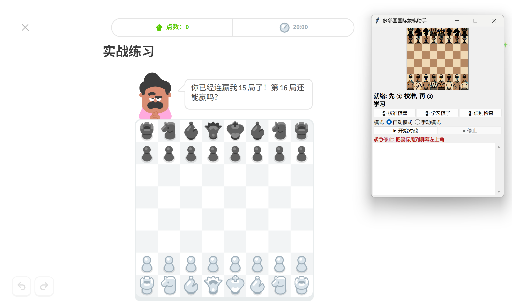

# ♟️ 电脑多邻国国际象棋辅助 · Elo 2000+

> 让 Stockfish 帮你在电脑端的 [多邻国国际象棋对战](https://www.duolingo.cn/chess-matches) 里走棋。
> 🧠 Stockfish 引擎 · 👁️ 屏幕识别 · 🖱️ 自动落子 · 📚 自动收录获胜棋谱

它通过截图识别棋盘，交给本地 Stockfish 计算，再用鼠标把棋走出来。全程在你自己的电脑上运行，不联网、不读网页数据。

> 关于 "Elo 2000+"：棋力来自 Stockfish，每步 1 秒的水平远高于 2000。这是引擎的通用水平，不是我对本软件在多邻国上做过的实测。

## 🖥️ 软件界面



---

## ✨ 主要功能

- 🖼️ **屏幕识别**：框选一次棋盘，学一遍棋子外观，之后自动识别局面，白方黑方都支持
- 🤖 **Stockfish 走棋**：本地引擎，可调线程数和哈希
- 🖱️ **自动落子**：默认拖动，也可以改成点击
- 🔁 **连续对战**：一局结束后自动等待下一局，黑方也能正常续上
- 🛑 **紧急停止**：鼠标甩到屏幕左上角立即中止
- 📝 **自动存棋谱**：每局保存为 PGN，带评分、搜索深度和对手失误估算

## 🎛️ 两种模式

### 🚀 自动模式（默认，一键开始）

界面上只有「开始对战」和「停止」。参数都已调好：

| 项目 | 自动模式的做法 |
| --- | --- |
| ⏱️ 思考时间 | 每步约 1 秒 |
| 🧵 线程 / 哈希 | CPU 核数减 2 / 512 MB |
| 🎨 我方颜色 | 按棋盘朝向自动判断 |
| 🤝 避免和棋 | 开启，每局累计最多让出约 40 厘兵的评分，用完就走最优步 |
| 🔍 先加深再决定 | 打算偏离最优步但搜索太浅时，先搜到深度 18 再决定 |
| 💤 死和局省时 | 连续多步评分都接近 0.00 时，每步只想 0.2 秒 |
| 📚 开局库 | 完整版开局库 |
| 🏆 自动收书 | 自动保存棋谱，并从**获胜**棋谱里学习路线，下一局优先重走（对手若是确定性的，同一条线会被反复验证） |

### 🛠️ 手动模式

界面类似经典版，所有参数自己调：

- ⏱️ 每步思考（秒）
- 🧵 线程数、💾 哈希（MB）
- 🎨 我方颜色（自动 / 白 / 黑）
- 🔄 中途接管时轮到谁
- 🖱️ 点击代替拖动
- 🤝 避免和棋
- 📥 收录棋谱到 `games/`（可选，默认关闭）

手动模式只用一个很小的默认开局库。勾选「收录棋谱」后，会保存棋谱并使用从获胜棋谱学到的对手库，和自动模式一样。

> ⚠️ 开局库和对手库只在勾选「避免和棋」时生效。

---

## 📦 安装

> 目前只支持 **Windows**（用到了 Windows 的 DPI 和鼠标接口，引擎也是 Windows 版）。

### 1️⃣ 安装 Python

安装 [Python 3.12](https://www.python.org/downloads/)，安装时勾选 **Add python.exe to PATH**。

### 2️⃣ 下载本项目并安装依赖

```bat
git clone <本仓库地址>
cd duolingo_chess
pip install -r requirements.txt
```

### 3️⃣ 下载 Stockfish

仓库里不带引擎（文件约 100 MB）。到 [Stockfish 官网](https://stockfishchess.org/download/) 下载 Windows 版，把可执行文件放到并改名为：

```
engine/stockfish/stockfish-windows-x86-64-universal.exe
```

> 路径写在 `duolingo_chess.py` 顶部的 `ENGINE` 变量里，想放别处可以改那一行。

### 4️⃣ 启动

双击 `start_gui.bat`，或者：

```bat
python duolingo_gui.py
```

---

## 🎮 使用步骤

1. 在浏览器里打开多邻国国际象棋对战页面，开一局新棋，让棋子都摆好。
2. 点 **① 校准棋盘**：按住左键从棋盘左上角拖到右下角，程序会自动贴合 8×8 网格。
3. 点 **② 学习棋子**：在**开局局面**下点一次（执黑时白方已走第一步也可以）。
4. 点 **③ 识别检查**（可选）：看界面上的棋盘和网页是否一致。
5. 选择模式，点 **▶ 开始对战**。

注意：

- 对战时别让本程序的窗口挡住棋盘，也别让弹窗遮住它。
- 浏览器缩放、窗口大小、屏幕分辨率变了，要重新校准和学习。
- 校准和学习的结果保存在本机（`board.json`、`templates.npz`），不会上传。

## ⌨️ 命令行（可选）

```bat
python duolingo_chess.py calibrate      :: 校准棋盘
python duolingo_chess.py learn          :: 学习棋子
python duolingo_chess.py check          :: 识别并输出调试图
python duolingo_chess.py play --auto    :: 自动模式
python duolingo_chess.py play --time 2 --threads 8 --hash 1024 --learn   :: 手动参数
```

`play` 的常用参数：`--time` 每步秒数、`--threads`、`--hash`、`--color auto|white|black`、`--turn us|them`、`--click`、`--allow-draw`（不避开和棋）、`--learn`（收录棋谱）。

## 📁 目录说明

| 路径 | 说明 |
| --- | --- |
| `duolingo_chess.py` | 识别、引擎调用、对战逻辑和命令行 |
| `duolingo_gui.py` | 图形界面 |
| `start_gui.bat` | 双击启动 |
| `requirements.txt` | Python 依赖（已固定版本） |
| `games/` | 每局棋谱（PGN），不会提交到仓库 |
| `engine/` | 放 Stockfish，不会提交到仓库 |

## ⚠️ 免责声明

- 本项目仅供学习和研究屏幕识别、国际象棋引擎之类的技术。
- 用自动化工具代替自己下棋，可能违反多邻国的服务条款，也会让你失去练习的意义。是否使用、后果如何，由你自己决定。
- 本项目与 Duolingo、Stockfish 没有任何隶属关系。Stockfish 是独立的开源项目（GPL-3.0），请遵守它的许可。

## 🙏 致谢

[Stockfish](https://stockfishchess.org/) · [python-chess](https://github.com/niklasf/python-chess) · [OpenCV](https://opencv.org/) · [mss](https://github.com/BoboTiG/python-mss) · [PyAutoGUI](https://github.com/asweigart/pyautogui)
